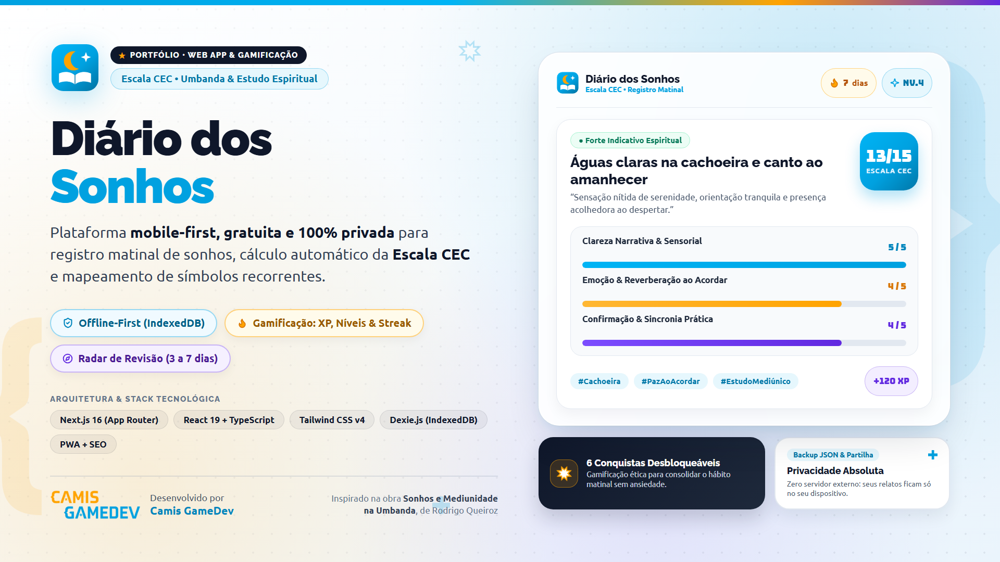

# Diário dos Sonhos — Escala CEC



Plataforma web **mobile-first**, gratuita e sem fins lucrativos para registro estruturado de sonhos e acompanhamento da **Escala CEC (Clareza, Emoção e Confirmação)**.

> **Referência e Direitos Autorais:** Esta plataforma é uma iniciativa independente, gratuita e não comercial, inspirada nos conceitos do livro ***Sonhos e Mediunidade na Umbanda***, de **Rodrigo Queiroz**. O sistema não reproduz, edita nem substitui a obra original (respeitando integralmente a Lei nº 9.610/1998) — funciona apenas como caderno digital interativo de apoio ao estudo pessoal.

---

## Principais Recursos

- **Registro Matinal Rápido (60–90s) Mobile-First:** Campos diretos para anotar título, relato, tags de símbolos, sentimentos ao acordar e pontos marcantes, além de acordeões opcionais para contexto pré-sono e reflexão profunda.
- **Cálculo Automático da Escala CEC (0 a 15 pontos):**
  - **Clareza (1 a 5):** nitidez narrativa e detalhes sensoriais.
  - **Emoção (1 a 5):** intensidade e duração afetiva ao despertar.
  - **Confirmação (0 a 5):** recorrência, sincronias, validação em terreiro ou desdobramentos práticos.
  - Classificação imediata em **Sonho Comum (0–6)**, **Em Observação (7–10)** e **Forte Indicativo Espiritual (11–15)**.
- **Privacidade Total com Banco de Dados Local (IndexedDB):** Todos os registros ficam armazenados apenas no navegador do usuário via `Dexie.js`, com exportação e importação de backup em arquivo `.json`.
- **Gamificação Camis GameDev (Conquistadores + Exploradores):**
  - Sistema de **XP**, **níveis** e **streak** diário para incentivar o hábito matinal.
  - **6 Conquistas desbloqueáveis** ilustradas com os símbolos oficiais da marca.
  - **Radar de Revisão (3 a 7 dias)** destacando registros que merecem reavaliação de confirmação.
  - **Mapa de Símbolos Recorrentes** e distribuição estatística pela Escala CEC.
- **Partilha Ética e Responsável:** Botão para copiar um resumo organizado caso o usuário queira dialogar com seu dirigente espiritual, grupo de estudos ou terapeuta.
- **Identidade Visual Camis GameDev (Tema 1):** Tema Claro como padrão obrigatório com alternância opcional para Tema Escuro, cantos arredondados e assinatura oficial no rodapé.
- **SEO & PWA:** Metadados completos em português, `sitemap.xml`, `robots.txt`, `manifest.webmanifest`, banners oficiais Open Graph (`1200×630`) e Portfólio (`1920×1080`), JSON-LD (`WebApplication` e `FAQPage`) e página educativa estática em `/guia-escala-cec`.

---

## Apoio Voluntário (Pix) e Link de Afiliado do Livro

Esta plataforma é **100% gratuita e aberta**. Você pode configurar sua chave Pix e o link de afiliado do livro *Sonhos e Mediunidade na Umbanda* de duas formas:

1. **Via variáveis de ambiente (recomendado):** copie `.env.example` para `.env.local` e preencha:
   ```env
   NEXT_PUBLIC_SITE_URL=https://seu-dominio.vercel.app
   NEXT_PUBLIC_BOOK_AFFILIATE_URL=https://amzn.to/SEU-LINK-DE-AFILIADO
   NEXT_PUBLIC_PIX_KEY=sua-chave-pix@email.com
   NEXT_PUBLIC_PIX_RECIPIENT=Seu Nome ou Camis GameDev
   ```
2. **Ou diretamente no arquivo central de configuração:** [`src/config/site.ts`](src/config/site.ts).

---

## Tecnologias Utilizadas

- **Next.js (App Router)** + **React** + **TypeScript**
- **Tailwind CSS v4**
- **Dexie.js** (`dexie` e `dexie-react-hooks`) para persistência local em IndexedDB
- **Lucide React** para iconografia
- **Submódulo de Identidade Visual:** `.agent/skills/cami-brand-identity`

---

## Como Executar Localmente

### 1. Clonar o repositório com o submódulo da marca
```bash
git clone --recurse-submodules https://github.com/marquesbelem/camis-game-dev-diario-dos-sonhos.git
cd camis-game-dev-diario-dos-sonhos
```

*(Caso já tenha clonado sem `--recurse-submodules`, execute `git submodule update --init --recursive`.)*

### 2. Instalar dependências
```bash
npm install
```

### 3. Configurar ambiente (opcional)
```bash
cp .env.example .env.local
```

### 4. Iniciar servidor de desenvolvimento
```bash
npm run dev
```

Acesse `http://localhost:3000` no navegador.

### 5. Validar lint e build de produção
```bash
npm run lint
npm run build
```

---

## Autoria

Desenvolvido por [Camis GameDev](http://cmbelem.vercel.app/)
